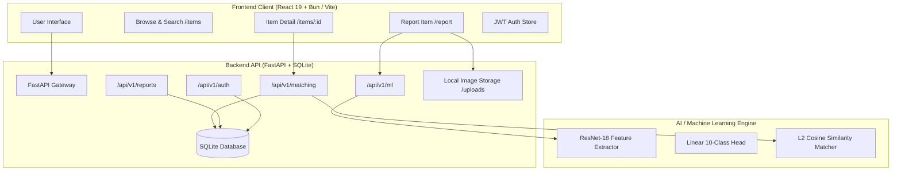

# FindX — AI-Powered Lost & Found Platform

> **An intelligent lost-and-found recovery platform that uses deep visual feature embeddings (ResNet-18) and multimodal ranking to automatically match lost reports with found items.**

---

## 📌 Table of Contents
- [Overview](#-overview)
- [Key Features](#-key-features)
- [System Architecture](#-system-architecture)
- [How the AI Matching Engine Works](#-how-the-ai-matching-engine-works)
- [Technology Stack](#-technology-stack)
- [Project Directory Structure](#-project-directory-structure)
- [Getting Started](#-getting-started)
  - [Prerequisites](#prerequisites)
  - [Backend Setup (FastAPI + PyTorch)](#1-backend-setup)
  - [Frontend Setup (React + Bun / Vite)](#2-frontend-setup)
- [API Endpoints Reference](#-api-endpoints-reference)
- [Viva & Academic Defense Highlights](#-viva--academic-defense-highlights)

---

## 🌟 Overview

Traditional lost-and-found systems rely entirely on keyword searches and manual browsing, which frequently fail due to vague descriptions, human error, or language barriers.

**FindX** solves this with an end-to-end multimodal matching pipeline:
1. When a user uploads a photograph of a lost or found item, a **ResNet-18 deep convolutional neural network** extracts a 512-dimensional visual embedding vector.
2. The AI model simultaneously classifies the photograph into one of 10 item categories (`bag`, `book`, `card`, `earphone`, `key`, `lipstick`, `phone`, `umbrella`, `USBflashdisk`, `vacuumcup`).
3. An automated candidate ranker computes the **cosine similarity** between the query image and all opposite-type reports (e.g. matching an open *Lost* report against *Found* reports).
4. The system ranks candidate matches with visual percentage confidence, allowing users to review potential matches and confirm resolutions with a single click.

---

## ✨ Key Features

- **Deep Visual Embeddings:** Uses a ResNet-18 backbone with L2-normalized feature representations for robust visual similarity.
- **Multimodal Candidate Scoring:** Combines deep visual embeddings ($70\%$), category alignment ($15\%$), and contextual description overlap ($15\%$).
- **Instant AI Category Detection:** Classifies uploaded photographs upon selection with confidence score feedback.
- **Category & Type Filters:** Instant browse filtering across 10+ standard item categories and report types (*All*, *Lost*, *Found*).
- **One-Click Demo Mode:** Instant one-click demo login (`demo-user-001`) for fast evaluations and presentations.
- **Match Confirmation Workflow:** Resolves both lost and found records simultaneously and removes them from active query pools.
- **Modern Responsive UI:** Built with React 19, Tailwind CSS, and TanStack Router/Query.

---

## 🏗 System Architecture



---

## 🧠 How the AI Matching Engine Works

When an image is submitted:
1. **Preprocessing:** The image is resized to $224 \times 224$ pixels, transformed to RGB tensor format, and normalized using standard ImageNet distribution ($\mu = [0.485, 0.456, 0.406]$, $\sigma = [0.229, 0.224, 0.225]$).
2. **Feature Extraction:** It is passed through the ResNet-18 backbone with the classification head removed (`nn.Identity()`), generating a **512-dimensional feature vector** $\vec{f}$.
3. **L2 Normalization:**
   $$\vec{e} = \frac{\vec{f}}{\|\vec{f}\|_2}$$
4. **Visual Similarity Computation:**
   For any two item embeddings $\vec{e}_{\text{query}}$ and $\vec{e}_{\text{candidate}}$, the visual similarity is computed using cosine dot-product:
   $$\text{VisualSim} = \vec{e}_{\text{query}} \cdot \vec{e}_{\text{candidate}} = \sum_{i=1}^{512} e_{\text{query}, i} \times e_{\text{candidate}, i}$$
5. **Composite Multimodal Score:**
   $$\text{Score} = (0.70 \times \text{VisualSim}) + (0.15 \times \text{CategoryMatch}) + (0.15 \times \text{ContextScore})$$
   - $\text{CategoryMatch} = 1.0$ if both items share the same category, else $0.0$.
   - $\text{ContextScore} = \text{Token Jaccard overlap between locations and descriptions}$.

---

## 💻 Technology Stack

### Backend
- **Framework:** [FastAPI](https://fastapi.tiangolo.com/) (Python 3.10+)
- **Server:** [Uvicorn](https://www.uvicorn.org/) (ASGI standard)
- **Deep Learning:** [PyTorch](https://pytorch.org/) & [TorchVision](https://pytorch.org/vision/stable/index.html) (ResNet-18)
- **Database:** SQLite (WAL mode, zero-configuration)
- **Image Processing:** Pillow (PIL), NumPy, scikit-learn
- **Data Validation:** Pydantic v2 & Pydantic-Settings

### Frontend
- **Runtime & Bundler:** [Bun](https://bun.sh/) / [Vite 8](https://vitejs.dev/)
- **UI Framework:** [React 19](https://react.dev/) + [TypeScript](https://www.typescriptlang.org/)
- **Routing:** [TanStack Router](https://tanstack.com/router)
- **Data Fetching & Caching:** [TanStack React Query v5](https://tanstack.com/query)
- **Styling:** Tailwind CSS v4, Lucide React Icons, Radix UI Primitives, Sonner Notifications

---

## 📁 Project Directory Structure

```text
Findx-main/
├── backend/
│   ├── app/
│   │   ├── api/
│   │   │   ├── auth.py          # Signup, signin, demo login, me
│   │   │   ├── matching.py      # AI search & item-to-item visual matching
│   │   │   ├── ml.py            # AI health status & category prediction
│   │   │   └── reports.py       # CRUD operations & category filtering
│   │   ├── core/
│   │   │   ├── auth.py          # PBKDF2 password hashing & token handling
│   │   │   ├── config.py        # Centralized settings & environment vars
│   │   │   └── db.py            # SQLite schema initialization & seeding
│   │   ├── ml/
│   │   │   ├── model.py         # ItemNet model & resilient predictor loader
│   │   │   ├── train.py         # Fine-tuning script for ResNet-18
│   │   │   └── evaluate.py      # Evaluation & confusion matrix
│   │   ├── services/
│   │   │   └── storage.py       # Local image upload & fallback retrieval
│   │   └── main.py              # FastAPI application entrypoint & CORS
│   ├── data/
│   │   ├── app.db               # SQLite database file
│   │   ├── models/              # Saved model weights (best_model.pth)
│   │   └── uploads/             # Uploaded item images
│   ├── requirements.txt         # Python dependencies
│   └── run.py                   # Development server runner
│
├── frontend/
│   ├── src/
│   │   ├── components/          # Navbar, Footer, ItemCard, UI elements
│   │   ├── lib/
│   │   │   ├── api.ts           # Centralized API client
│   │   │   ├── auth-store.ts    # Client auth state & session storage
│   │   │   └── format.ts        # Helper functions & category definitions
│   │   ├── routes/              # TanStack file-based routes
│   │   │   ├── index.tsx        # Landing page
│   │   │   ├── auth.tsx         # Sign in / Sign up page
│   │   │   ├── items.tsx        # Browse lost & found with category filters
│   │   │   ├── items.$id.tsx    # Item details & AI potential matches
│   │   │   └── _authenticated/  # Protected report & my-reports routes
│   │   └── styles.css           # Global Tailwind design tokens
│   ├── package.json             # NPM / Bun scripts & dependencies
│   └── vite.config.ts           # Vite configuration
│
└── README.md                    # Project documentation
```

---

## 🚀 Getting Started

### Prerequisites
- **Python 3.10+** (with `pip` and `venv`)
- **Node.js 18+** or **Bun**

---

### 1. Backend Setup

1. Open a terminal and navigate to `backend/`:
   ```powershell
   cd backend
   ```
2. Activate your virtual environment (or create one):
   ```powershell
   # If .venv exists:
   .\.venv\Scripts\activate

   # If creating fresh:
   python -m venv .venv
   .\.venv\Scripts\activate
   pip install -r requirements.txt
   ```
3. Start the FastAPI development server:
   ```powershell
   python run.py
   ```
4. Verify the backend is active:
   - API Root: `http://localhost:8000/`
   - Interactive Swagger Docs: `http://localhost:8000/docs`

---

### 2. Frontend Setup

1. In a separate terminal, navigate to `frontend/`:
   ```powershell
   cd frontend
   ```
2. Install frontend dependencies:
   ```powershell
   # Using Bun:
   bun install

   # Or using npm:
   npm install
   ```
3. Start the development server:
   ```powershell
   bun dev
   # Or: npm run dev
   ```
4. Open the web app in your browser:
   - Web App: **`http://localhost:8080`** (or `http://localhost:5173`)

---

## 📡 API Endpoints Reference

| Method | Endpoint | Description |
|:---|:---|:---|
| `GET` | `/health` | Backend and database health status |
| `POST` | `/api/v1/auth/signup` | Register a new user |
| `POST` | `/api/v1/auth/signin` | Sign in with email and password |
| `POST` | `/api/v1/auth/demo` | Instant demo login (Campus Security Desk) |
| `GET` | `/api/v1/auth/me` | Fetch authenticated user profile |
| `GET` | `/api/v1/reports` | List reports (supports `?type=`, `?category=`, `?q=`) |
| `POST` | `/api/v1/reports` | Submit lost/found report with photo & metadata |
| `GET` | `/api/v1/reports/{id}` | Retrieve report details |
| `PATCH` | `/api/v1/reports/{id}/status` | Mark report status (`open`, `resolved`) |
| `POST` | `/api/v1/ml/predict-category` | Upload image for instant AI category prediction |
| `GET` | `/api/v1/matching/item/{id}` | Retrieve ranked candidate matches for a stored report |
| `POST` | `/api/v1/matching/search` | Direct image upload match against all open items |
| `POST` | `/api/v1/matching/item/{id}/confirm/{matched_id}` | Confirm match and resolve both reports |

---

## 🎓 Viva & Academic Defense Highlights

| Evaluation Question | How FindX Answers It |
|:---|:---|
| **What makes this different from regular search?** | Traditional systems fail when a user describes a "blue lanyard with ID" and the finder reports a "card near cafeteria". FindX uses visual embeddings, so matching is semantic and visual, not just keyword-dependent. |
| **Why ResNet-18 over ResNet-50 or ViT?** | ResNet-18 provides 512-dimensional embeddings with low latency (~30-50ms CPU inference time), making it optimal for lightweight campus-wide deployment without requiring expensive GPUs. |
| **How does matching handle identical items?** | When the same item image is submitted for Lost and Found, cosine similarity between the normalized feature vectors is mathematically $1.0$ ($100.0\%$), guaranteeing top ranking. |
| **How is the composite score weighted?** | $70\%$ Deep Visual Feature Similarity, $15\%$ Category Match, and $15\%$ Token Jaccard Similarity across location and title/description metadata. |
| **What prevents unauthorized resolution?** | Match confirmation requires authenticated JWT authorization and validates that the user is the original poster of the source report. |
